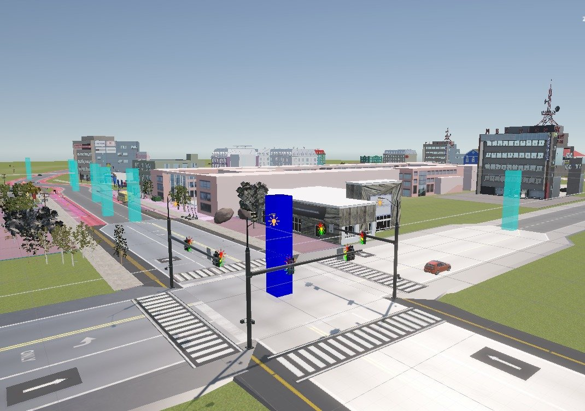
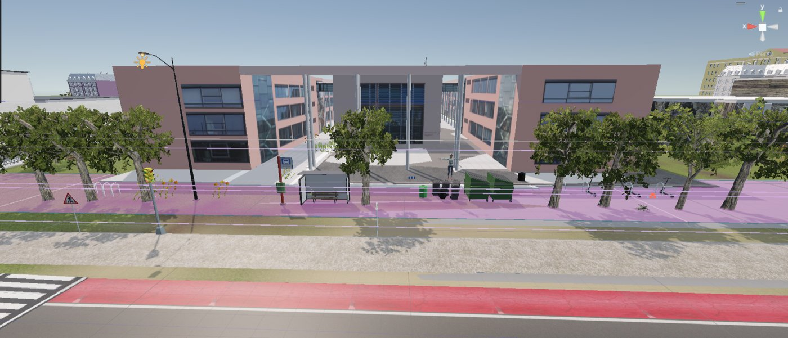
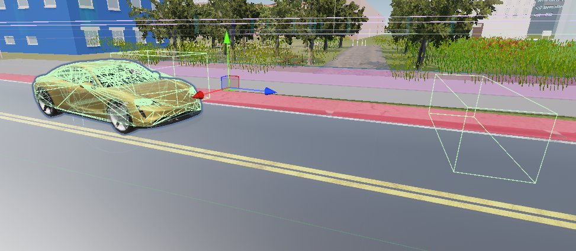
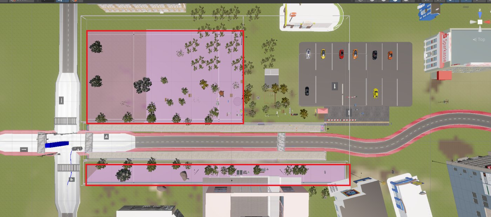
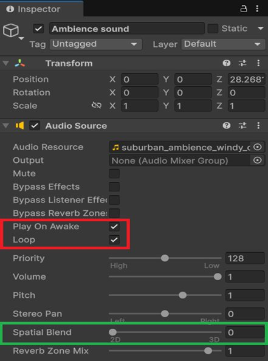
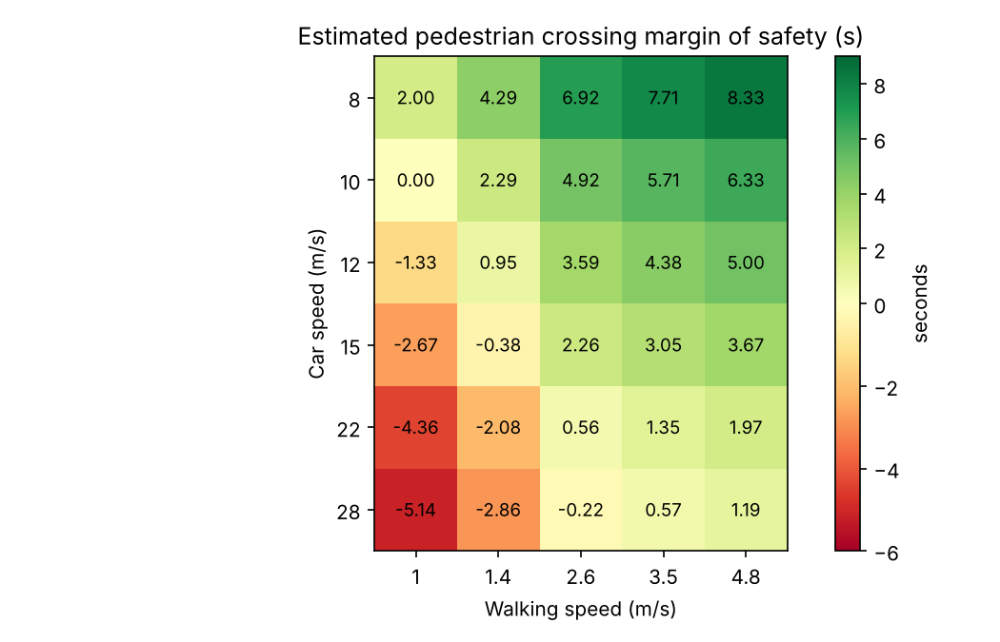
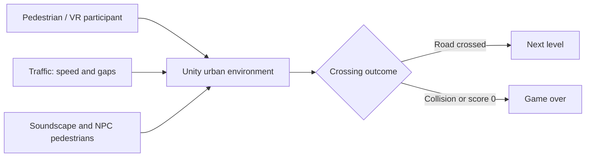

<div align="center">

# VR Pedestrian Simulator

### Immersive Road-Crossing Simulation with Dynamic Virtual Traffic

**Unity** · **C#** · **Meta Quest 3** · **Traffic Simulation** · **Spatial Audio** · **Python**

**Seven-member university team project · Mechatronics and Cyber-Physical Systems · Deggendorf Institute of Technology**

[**Project Report (PDF)**](docs/VR_Pedestrian_Simulator_Report.pdf) · [**Source Code**](#explore-the-code) · [**Run the Demo**](docs/unity_demo.md) · [**Analysis**](#crossing-time-analysis) · [**Team**](docs/team_and_attribution.md)

</div>

<p align="center">
  
  <br><sub>Road network from the team's Unity simulator.</sub>
</p>

## About the project

How do people decide when it is safe to cross a road, and can a risk-free virtual
street help them make better decisions? To explore this, our team of seven built a
VR pedestrian simulator in Unity for the Meta Quest 3.

The user stands at a street in a realistic city and has to reach the other side
while cars drive past. Three levels make it harder step by step, from slow traffic
with big gaps to fast traffic with very small gaps. A live score, the speed of nearby
cars and a "Game over" sequence give instant feedback. Footsteps, city ambience and
3D engine sounds with Doppler effect help the user hear traffic they cannot see.

## Project report

The full team report covers the system architecture, environment and road design,
traffic and gameplay, NPC pedestrians, audio, Meta Quest 3 integration and the
crossing-time experiments.

<p align="center">
  <a href="docs/VR_Pedestrian_Simulator_Report.pdf"></a>
  &nbsp;
  <a href="https://github.com/sajin-saji/vr-pedestrian-simulator/raw/main/docs/VR_Pedestrian_Simulator_Report.pdf"></a>
</p>

## Project highlights

| System | Overview |
| --- | --- |
| **Environment** | Urban roads to EU standards, crossings, sidewalks, bike lanes, buildings recreated from OpenStreetMap |
| **Traffic** | Waypoint-following cars with configurable speed, acceleration and gaps |
| **Player** | First-person movement, collision detection, Game Over sequence |
| **Levels** | Three difficulty levels with automatic scene loading |
| **Feedback** | Score (minus 10 per car missed), live car speed, navigation arrow |
| **Atmosphere** | NPC pedestrians on a NavMesh, day/night cycle, rain and snow, birds |
| **Audio** | Footsteps, crowds, 2D city ambience, 3D engine sound with Doppler, idling bus |
| **VR** | Meta XR Core, Interaction and Movement SDKs with full-body tracking |

## Project screenshots

<table>
  <tr>
    <td width="50%"></td>
    <td width="50%"></td>
  </tr>
  <tr><td><strong>Virtual environment</strong><br><sub>Building recreated from OpenStreetMap</sub></td><td><strong>Traffic interaction</strong><br><sub>Roadside trigger volumes for scoring</sub></td></tr>
  <tr>
    <td></td>
    <td></td>
  </tr>
  <tr><td><strong>Walkable areas</strong><br><sub>NavMesh zones for NPC pedestrians</sub></td><td><strong>Audio setup</strong><br><sub>Ambient sound in Unity</sub></td></tr>
</table>

## Explore the code

> **About this code:** The original team project used Asset Store packs and Meta SDKs that cannot be shared, so it is not in this repository. The `Assets/` folder contains a **desktop version made later for this portfolio** that shows the same core ideas in plain Unity and C#: crossing, traffic, levels, score and audio. It runs with keyboard and mouse and needs no headset.

| File | What it does |
| --- | --- |
| [Scene builder](Assets/Scripts/Editor/PedestrianShowcaseBuilder.cs) | Editor menu that builds the street, crosswalk, buildings, trees, player, traffic and triggers |
| [First-person controller](Assets/Scripts/Runtime/Player/PedestrianFirstPersonController.cs) | Walking, running and mouse look |
| [Traffic spawner](Assets/Scripts/Runtime/Traffic/DemoTrafficSpawner.cs) | Spawns cars with level-dependent speed and gaps |
| [Vehicle](Assets/Scripts/Runtime/Traffic/DemoVehicle.cs) | Moves a car, counts it as passed, reports collisions |
| [Session](Assets/Scripts/Runtime/Simulation/ShowcaseSession.cs) | Levels, score, collision, Game Over and restart |
| [Footstep audio](Assets/Scripts/Runtime/Audio/PedestrianFootstepAudio.cs) | Footsteps based on the distance actually walked |
| [Soundscape](Assets/Scripts/Runtime/Audio/EnvironmentSoundscape.cs) | 2D city ambience and 3D crowd sound |
| [Vehicle audio](Assets/Scripts/Runtime/Audio/SpatialVehicleAudio.cs) | 3D engine sound with Doppler; pitch and volume follow speed |
| [Sound generator](tools/generate_audio.py) | Python script that synthesises the footsteps, city ambience, crowd and engine sounds |

```text
Assets/
├── Scripts/
│   ├── Editor/                 # Scene builder (Unity menu)
│   └── Runtime/
│       ├── Audio/              # Footsteps, ambience, vehicle audio
│       ├── Player/             # First-person movement
│       ├── Traffic/            # Car spawning and movement
│       └── Simulation/         # Levels, score, crossing triggers
└── Audio/Demo/                 # Footsteps, city ambience, crowd, engine loop
tools/
└── generate_audio.py           # Synthesises all demo sounds (no recordings)
```

### Run the desktop demo

1. Open the repository folder in **Unity 2022.3 LTS** (built-in render pipeline).
2. Choose **Tools → Pedestrian Simulator → Generate Desktop Showcase Scene**.
3. Press **Play**. **WASD** to move, **mouse** to look, **Shift** to run, **R** to restart.

Details: [docs/unity_demo.md](docs/unity_demo.md)

## Crossing-time analysis

The team used a simple timing model to check whether a pedestrian can cross before
an approaching car arrives:

$$
\text{Margin} = \frac{\text{Car distance}}{\text{Car speed}} - \frac{\text{Road width}}{\text{Walking speed}}
$$

A negative margin means the car arrives before the pedestrian is across. The road
width was 8 m. The car distance is not stated in the team's results, but a distance
of 80 m reproduces all of them within 0.02 s, so the script uses that value.

<p align="center"></p>

At a slow walk (1 m/s), any car faster than 10 m/s (36 km/h) leaves no time to
cross. At 28 m/s (about 100 km/h), even a fast walk is not enough; you have to run.
This is the idea behind the hardest level.

```bash
python -m pip install -r requirements.txt
python analysis/margin_of_safety.py
python -m unittest discover -s tests -v
```

The model leaves out braking, reaction time and real participant data, so it is a
teaching tool, not a real-world safety predictor. [CSV results →](analysis/results/margin_of_safety.csv)

## Architecture



## Team

This was a collaborative project of seven students. We built the simulator
together across environment design, traffic, gameplay, NPCs, audio, VR integration
and testing. See [team and credits](docs/team_and_attribution.md).

**Team members:** Ashish Uriviti · Kowshik Karnam Kesavalu · Krishna Gaadha · Muhammad Talha ·
Naveenraj Palanisamy · Sai Kiran Vankayalapati · Sajin Saji

## Documentation

- [Project report (PDF)](docs/VR_Pedestrian_Simulator_Report.pdf): the team's full paper — design, implementation, audio, VR integration and analysis
- [Desktop demo setup and test checklist](docs/unity_demo.md)
- [Team and asset credits](docs/team_and_attribution.md)
